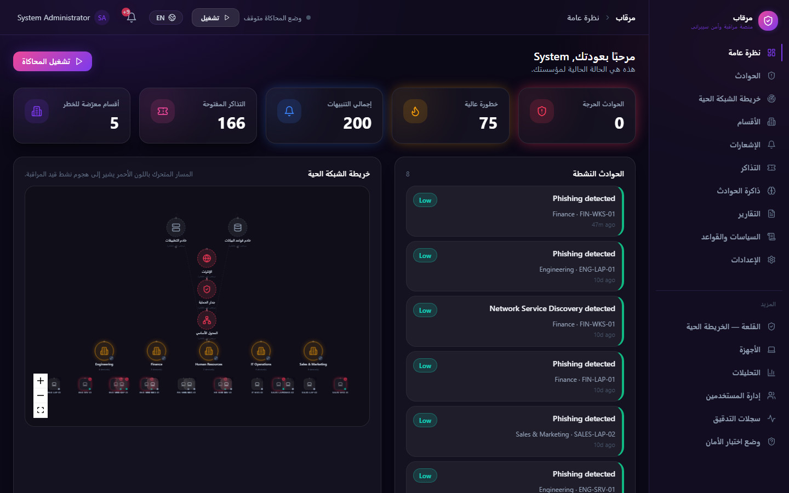
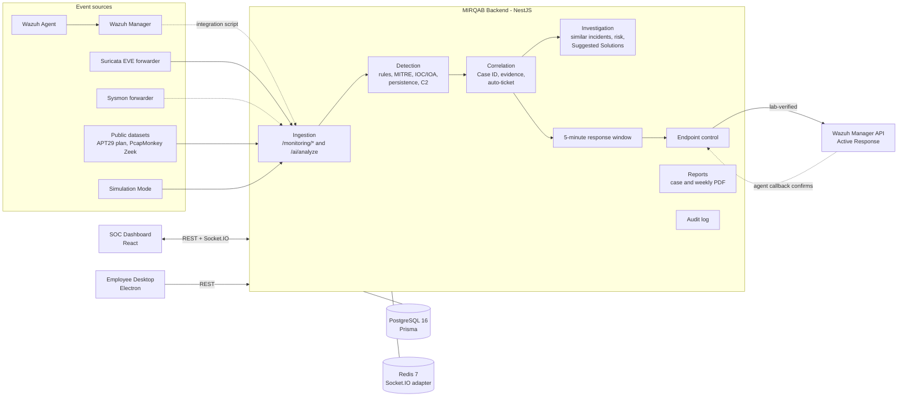
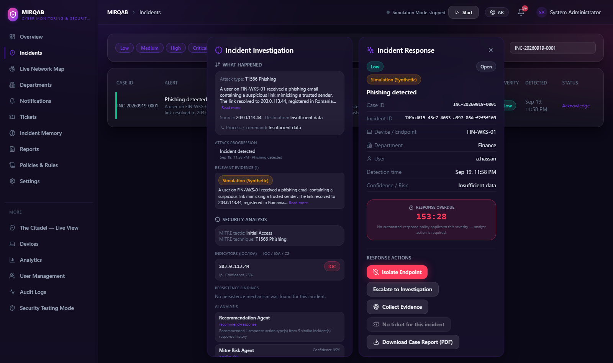
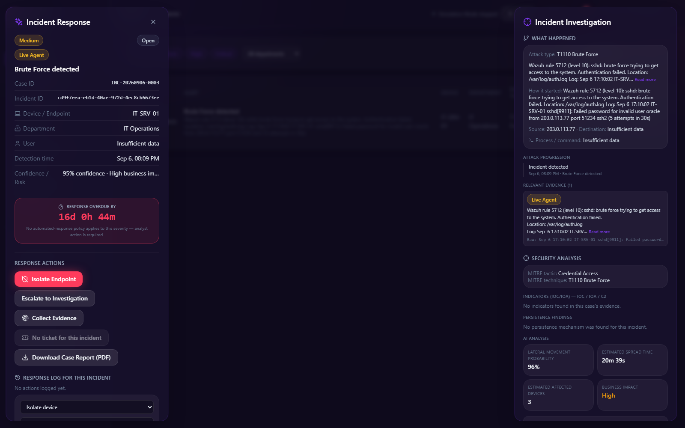

# MIRQAB – AI-Powered SOC Platform

**MIRQAB** (Arabic: مرقاب, "watchtower") is a Security Operations Center (SOC) platform for small and medium-sized businesses. It turns raw security events into investigated, explainable incidents and attaches a timed, human-controlled response to every high-severity case.

> **Status:** working prototype that runs locally in Docker. It is **not deployed to production**. Analysis is **deterministic and rule-based by default**, and device isolation has been **verified in a lab only**. See [Project Status & Limitations](#18-project-status--limitations).



---

## Contents

1. [Project Overview](#1-project-overview)
2. [Problem Statement](#2-problem-statement)
3. [Key Capabilities](#3-key-capabilities)
4. [High-Level Architecture](#4-high-level-architecture)
5. [Security Operations Workflow](#5-security-operations-workflow)
6. [AI / Multi-Agent Architecture](#6-ai--multi-agent-architecture)
7. [Detection & Analysis](#7-detection--analysis)
8. [MITRE ATT&CK Mapping](#8-mitre-attck-mapping)
9. [IOC / IOA Extraction](#9-ioc--ioa-extraction)
10. [Incident Management](#10-incident-management)
11. [Risk & Severity Analysis](#11-risk--severity-analysis)
12. [Device Isolation](#12-device-isolation)
13. [Technology Stack](#13-technology-stack)
14. [Project Structure](#14-project-structure)
15. [Demo / Quick Start](#15-demo--quick-start)
16. [Documentation](#16-documentation)
17. [Team](#17-team)
18. [Project Status & Limitations](#18-project-status--limitations)

---

## 1. Project Overview

MIRQAB consists of two applications that share one backend:

| Application | Path | Description |
|---|---|---|
| **SOC Dashboard** | `apps/soc-dashboard` | React web app for administrators, security analysts and IT technicians: overview, incidents, live network map, departments, notifications, tickets, incident memory, reports, policies, devices, analytics, user management, audit logs and "The Citadel" live view. Arabic (RTL) and English, dark and light themes. |
| **Employee Desktop** | `apps/employee-desktop` | Electron + React desktop agent for employees: device health, security score, device information and incident history. Partly uses clearly marked mock data. |
| **Backend API** | `backend` | NestJS modular monolith (`/api/v1`) with PostgreSQL (Prisma), Redis, JWT authentication, role-based access control and a Socket.IO realtime gateway. |

The project deliberately favors **deterministic, auditable logic**. AI is kept inside a strict, optional boundary and can never execute a response on its own.

## 2. Problem Statement

Small and medium-sized businesses face the same attacks as large enterprises (phishing, credential brute force, ransomware, command-and-control beacons) but rarely have a staffed SOC.

- **Too many raw alerts, too little context.** Tools such as Wazuh and Suricata produce low-level events. Turning them into an understandable incident (what happened, on which device, how serious, what to do) takes expertise an SMB often lacks.
- **Slow response.** Without a clear owner and a deadline, a high-severity alert can sit unacknowledged.
- **Unsafe automation.** Fully automatic responses that cannot be explained or audited are risky.

MIRQAB gives an SMB the core SOC workflow without a SOC-sized team. Every event becomes an explainable incident, every high-severity incident gets a clock, and every response, human or automated, is authorized, confirmed and recorded.

## 3. Key Capabilities

| Capability | What it does | Status |
|---|---|---|
| Event ingestion | Wazuh, Suricata, Sysmon, syslog and PCAP/Zeek-format events through `/monitoring/*` endpoints protected by an API key | Wazuh-format payloads and Suricata forwarder verified; Sysmon forwarder not verified |
| Detection & enrichment | Rule-based classification, severity, MITRE ATT&CK mapping (12 techniques), IOC/IOA extraction, persistence and C2 detection | Verified |
| Correlation & cases | Related events merge into one case (72-hour window, similarity score ≥ 65) with a Case ID such as `INC-20260919-0001` | Verified |
| Investigation workspace | Two-window incident view: Incident Response (actions) and Incident Investigation (what happened, evidence, MITRE, indicators, analysis) | Verified |
| Suggested Solutions | Technique-specific fixes plus actions that worked on similar past incidents; high-impact actions require approval | Verified |
| 5-minute response window | Countdown, acknowledgement and a once-only containment decision for HIGH/CRITICAL incidents | Verified (automated success on a live device: limited) |
| Device isolation | Wazuh Active Response with an agent-confirmed result | **Verified in lab only** |
| Live network map | Departments, devices and active attacks; "The Citadel" live view and an APT29 attack-path view | Verified |
| Reports | Per-incident case report PDF and a weekly SOC report PDF (scheduled and on demand) | Verified |
| Security & governance | JWT authentication, 4-role RBAC, department and organization scoping, read-only audit log, rate limiting | Verified |
| Realtime updates | Socket.IO events refresh the dashboard; Redis adapter for multiple backend replicas | Verified |
| Bilingual UI | Arabic (right-to-left) and English | Limited (some labels untranslated) |

Status labels come from the project's [Project Submission](docs/submission/MIRQAB_Project_Submission.pdf) and [Technical Architecture](docs/architecture/MIRQAB_Technical_Architecture.pdf) documents.

## 4. High-Level Architecture

MIRQAB is a TypeScript monorepo. In the diagram below, dashed links are implemented but **not verified live**.



**Wazuh components:** MIRQAB uses the **Wazuh Manager API** for Active Response (and optional logtest enrichment) and receives Wazuh-format alerts on `/monitoring/wazuh`. The **Wazuh Indexer and Wazuh Dashboard are not part of MIRQAB's data path**. They only ran inside the upstream `wazuh-docker` lab stack the team used for isolation testing, which is not included in this repository.

**Deployment:** both Docker Compose stacks run PostgreSQL, Redis, the backend, the SOC Dashboard and an nginx gateway:

- `infra/demo` is the evaluator demo, plain HTTP on `127.0.0.1:8080`.
- `infra/docker` is the development stack, with self-signed TLS and support for multiple backend replicas.

## 5. Security Operations Workflow

```mermaid
flowchart LR
    A["Security telemetry"] --> B["Wazuh / Suricata /<br/>network events"]
    B --> C["Alert ingestion<br/>/monitoring/*"]
    C --> D["Parsing and<br/>normalization"]
    D --> E["Rule-based detection<br/>IOC/IOA extraction"]
    E --> F["MITRE ATT&CK<br/>mapping"]
    F --> G["Severity and<br/>risk analysis"]
    G --> H["Correlation into a case<br/>incident + ticket"]
    H --> I["Analyst dashboard<br/>realtime"]
    I --> J["Response / isolation<br/>where supported"]
```



1. A forwarder posts an event to `/monitoring/wazuh`, `/monitoring/suricata`, `/monitoring/sysmon`, `/monitoring/syslog` or `/monitoring/pcap` with an `X-Api-Key` header. Analysts can also submit log text to `/ai/analyze`, which requires a JWT.
2. The monitoring service normalizes the vendor format, then the analysis pipeline classifies it, assigns a severity and a MITRE technique, and enriches it with indicators, persistence findings and C2 patterns.
3. Correlation either attaches the event to an open case (72-hour window, score ≥ 65) or opens a new Case ID with evidence.
4. HIGH/CRITICAL incidents automatically get a ticket, a "response required" notification and a **5-minute response window**.
5. Domain events are broadcast over Socket.IO to the dashboard rooms the user is allowed to see.
6. If an analyst acknowledges the incident in time, automated containment is cancelled for good. If the window expires, MIRQAB makes **one** recorded containment decision. Isolation is only attempted when a policy and an endpoint-control provider are configured.

## 6. AI / Multi-Agent Architecture

MIRQAB's "AI" layer is **deliberately conservative**.

| Aspect | Actual implementation |
|---|---|
| **Default behavior** | **100% deterministic, rule-based analysis.** No language model runs at runtime. Every AI-eligible task has a rule-based fallback, and the fallback is what runs by default. |
| **"Agents"** | The four agents shown in the interface (Incident Agent, IOC/IOA Agent, MITRE Risk Agent, Recommendation Agent) are **named, least-privilege wrappers around deterministic services**, not autonomous LLM agents. Their decisions are recorded for audit. |
| **Provider slot** | One AI provider can be configured at a time, never chained. The intended direction is a **self-hosted model** inside the customer's network (`SELF_HOSTED_AI_URL`). This provider is implemented and tested, but **no model has been deployed**. |
| **Anthropic Claude** | An integration exists **for development comparison only**. It needs both `ANTHROPIC_API_KEY` **and** `ALLOW_EXTERNAL_AI_DEV_ONLY=true`. It is **disabled by default and in the demo**, and it is not used at runtime. |
| **Safety boundary** | Prompt-injection delimiting, strict output validation (severity and MITRE IDs are checked against the reference data), circuit breaker, timeouts and a concurrency cap. AI output can inform an analyst; **it can never execute a response**. |
| **Similarity engine** | A native vector-similarity engine finds similar past incidents. It is equivalent to an inner-product index and needs no native FAISS binary. |

## 7. Detection & Analysis

Detection is performed by **deterministic rules** in `backend/src/modules/ai`:

- **Classification and severity:** rule-based matching of the normalized event text. Events that match no rule stay `UNCLASSIFIED`.
- **Enrichment:** IOC/IOA extraction, persistence-mechanism detection and command-and-control pattern detection (`ai/detection`, `ai/enrichment`).
- **Optional Wazuh logtest enrichment** through the Wazuh Manager API, when configured.
- **Similar incidents:** native vector similarity over past incidents (`ai/similarity-engine`) feeds the investigation view and Suggested Solutions.

Supported event sources:

| Source | Integration | Status |
|---|---|---|
| **Wazuh** | `/monitoring/wazuh` endpoint; Manager-side integration script `infra/monitoring/wazuh/mirqab-integration.py` | Endpoint verified with Wazuh-format payloads; Manager script **not run live** |
| **Suricata** | `infra/monitoring/suricata/eve-forwarder.js` tails `eve.json` and posts to `/monitoring/suricata` | Verified live |
| **Sysmon** | `infra/monitoring/sysmon/sysmon-forwarder.ps1` | Endpoint contract verified; script **not run** against real Sysmon |
| **Zeek** | Zeek-format network events from the public PcapMonkey dataset, imported through `/monitoring/pcap` | Demo data only; no live Zeek sensor integration |
| **APT29 emulation plan** | OTRF Security-Datasets APT29 plan imported for the demo | Demo data |
| **Simulation Mode** | Dashboard generator that posts synthetic events to the real analysis pipeline | Simulation |

## 8. MITRE ATT&CK Mapping

Each classified event is mapped to one of **12 curated MITRE ATT&CK techniques** defined in `backend/src/modules/ai/mitre-attack/mitre-reference.data.ts`. AI output, when enabled, is validated against this reference to reject hallucinated technique IDs.

| ID | Technique | ID | Technique |
|---|---|---|---|
| T1566 | Phishing | T1486 | Data Encrypted for Impact |
| T1110 | Brute Force | T1071 | Application Layer Protocol |
| T1204 | User Execution | T1053 | Scheduled Task/Job |
| T1046 | Network Service Discovery | T1078 | Valid Accounts |
| T1068 | Exploitation for Privilege Escalation | T1059 | Command and Scripting Interpreter |
| T1105 | Ingress Tool Transfer | T1567 | Exfiltration Over Web Service |

Coverage is intentionally limited to these 12 techniques, and events outside them remain `UNCLASSIFIED`.

## 9. IOC / IOA Extraction

The IOC/IOA Agent extracts **indicators of compromise and indicators of attack** (for example IP addresses) from incident evidence. It stores them as `Indicator` records with a type and a confidence value, and shows them in the investigation panel next to persistence findings and C2 patterns.



*Simulated phishing incident: evidence, MITRE technique T1566, an extracted IP indicator, agent analysis and response actions.*

## 10. Incident Management

- **Case IDs** in the form `INC-YYYYMMDD-NNNN`, with evidence and an attack-progression timeline.
- **Automatic tickets** for HIGH/CRITICAL incidents. Tickets can be reassigned and change status.
- **Statuses and actions:** acknowledge, investigate, resolve, approve or reject recommended actions, collect evidence and escalate.
- **Incident Memory:** past incidents and the actions that resolved them feed Suggested Solutions.
- **Notifications** to SOC staff ("response required", "containment result").
- **Reports:** a downloadable case report PDF per incident and a weekly SOC report PDF (scheduled every Monday 05:00 UTC, or on demand).
- **Audit log:** a server-derived actor is recorded on every action, denied and failed-login attempts are logged, and the audit API is read-only.

## 11. Risk & Severity Analysis

- **Severity** (LOW, MEDIUM, HIGH, CRITICAL) is assigned by the deterministic classification rules.
- **Risk estimates** shown in the investigation view (lateral-movement probability, estimated spread time, estimated affected devices, business impact) are **statistical estimates, not machine-learning predictions**.
- **Confidence** values accompany MITRE mappings and indicators.
- HIGH and CRITICAL severity trigger the auto-ticket and the 5-minute response window.



## 12. Device Isolation

> **Lab-verified capability. This is not production endpoint isolation.**

- MIRQAB requests isolation through an **endpoint-control provider**. The implemented provider uses **Wazuh Active Response**. An isolate-host script on the Wazuh agent applies firewall rules and reports back to `/devices/endpoint-control/active-response-result`.
- An action stays `PENDING` until the **agent's callback** confirms `SUCCESS` or `FAILED`. MIRQAB never assumes success.
- Isolation is always an **authorized, confirmed and audited** action. Automated isolation happens only once per incident, after the 5-minute window expires without acknowledgement, and only if a policy and a provider are configured.

Verified scope and limits:

- **Verified in a lab:** 2 of 2 end-to-end isolations on a **containerized Linux safe-test agent**.
- **Not tested on physical employee devices.** The Windows script is not verified.
- **Releasing** an isolated device is **not implemented** in the application.
- Automated containment has **not** been shown to succeed live outside the lab.
- The evaluator demo has **no endpoint-control provider**. "Isolate Endpoint" only shows the confirmation flow and nothing is isolated.

## 13. Technology Stack

| Layer | Technologies |
|---|---|
| Language | TypeScript (Node.js 20 in the Docker images) |
| Backend | NestJS 10, Prisma 5, PostgreSQL 16, Redis 7, Socket.IO, Passport JWT, Joi, Helmet, PDFKit |
| SOC Dashboard | React 18, Vite, Tailwind CSS, TanStack React Query, Zustand, React Flow, Recharts, Socket.IO client |
| Employee Desktop | Electron 29, React 18, Vite |
| Security tooling | Wazuh (Manager API, Active Response), Suricata (EVE JSON), Sysmon, Zeek-format dataset events, MITRE ATT&CK |
| Infrastructure | Docker, Docker Compose, nginx |
| Testing | Jest (38 backend test suites, 421 tests passing as of 27 Sep 2026), Playwright-based UI check scripts |
| Optional AI | Self-hosted provider interface; Anthropic Claude SDK (development-only, disabled by default) |

## 14. Project Structure

```
mirqab-ai-soc-platform/
├── apps/
│   ├── soc-dashboard/        # React + Vite SOC web dashboard (Dockerfile, nginx config, e2e checks)
│   └── employee-desktop/     # Electron + React employee desktop agent
├── backend/                  # NestJS API
│   └── src/
│       ├── modules/          # ai, alerts, audit-logs, auth, demo, departments, devices,
│       │                     # incident-memory, incidents, monitoring, notifications,
│       │                     # policies, reports, security-testing, simulation,
│       │                     # threat-intel, tickets, users, websocket
│       ├── common/           # guards, decorators, filters, pipes, validators
│       ├── config/           # configuration and environment validation
│       ├── database/         # Prisma schema, migrations, seed
│       └── redis/
├── infra/
│   ├── demo/                 # one-command evaluator demo (Docker Compose)
│   ├── docker/               # development stack (Compose, nginx TLS, Redis, Postgres)
│   ├── monitoring/           # Wazuh, Suricata and Sysmon forwarders / integration scripts
│   └── simulation/
├── datasets/                 # license-cleared public datasets used by the demo
├── scripts/                  # PowerShell test scripts (login, ingestion, scaling, ...)
├── packages/                 # shared-types, ui-kit, config (placeholders)
├── ai-engine/                # early standalone AI service stub, superseded by backend/src/modules/ai
├── mirqab/
└── docs/                     # documentation, see below
```

## 15. Demo / Quick Start

The evaluator demo runs entirely on `localhost`. It imports public, license-cleared security data (the OTRF APT29 emulation plan and PcapMonkey Zeek events) through MIRQAB's own pipeline. It uses **no external AI** and **cannot isolate endpoints**.

**Requirements:** Docker with Docker Compose v2, internet access for the first build, and free local port 8080.

```bash
git clone https://github.com/ii1nn/mirqab-ai-soc-platform.git
cd mirqab-ai-soc-platform

# Create your local demo configuration from the safe template
cp infra/demo/.env.demo.example infra/demo/.env.demo
# Edit infra/demo/.env.demo and set your own values (see below)

docker compose -f infra/demo/docker-compose.demo.yml --env-file infra/demo/.env.demo up -d --build
```

Then open **http://localhost:8080** and sign in with the `DEMO_ADMIN_EMAIL` / `DEMO_ADMIN_PASSWORD` you chose.

| Variable in `infra/demo/.env.demo` | Value |
|---|---|
| `DEMO_ADMIN_EMAIL` | Admin login email (template default `admin@mirqab.local`) |
| `DEMO_ADMIN_PASSWORD` | Your own password, 8+ characters (required) |
| `POSTGRES_PASSWORD`, `JWT_ACCESS_SECRET`, `JWT_REFRESH_SECRET`, `MONITORING_INGEST_API_KEY` | Random strings you generate, for example with `openssl rand -hex 32`. JWT secrets need at least 32 characters (required) |
| `DEMO_ANALYST_*`, `DEMO_TECHNICIAN_*` | Optional RBAC demo accounts |
| `DEMO_HTTP_PORT` | Optional, default `8080` |

Full step-by-step instructions, health checks, the demo workflow and shutdown steps are in **[docs/demo/RUN_DEMO.md](docs/demo/RUN_DEMO.md)**.

**Development setup:** each application has its own README with local commands: [`backend/README.md`](backend/README.md), [`apps/soc-dashboard/README.md`](apps/soc-dashboard/README.md) and [`apps/employee-desktop/README.md`](apps/employee-desktop/README.md). The development Compose stack is in `infra/docker`. Each component ships a `.env.example` template. Copy it to `.env` and fill in your own values.

> **Note:** `apps/soc-dashboard/vite.config.ts` currently points the local Vite dev-server proxy (`npm run dev` only) at `http://localhost:13000`, a leftover QA setting. Change the proxy target to your backend before using `npm run dev`. The Docker builds are not affected.

## 16. Documentation

| Document | Description |
|---|---|
| [User Guide](docs/guides/MIRQAB_User_Guide.pdf) | How an analyst or administrator uses MIRQAB |
| [Technical Architecture](docs/architecture/MIRQAB_Technical_Architecture.pdf) | Reference vs. actual flow, components, deployment, sequences, data model |
| [Complete Technical Documentation](docs/architecture/MIRQAB_Complete_Technical_Documentation.pdf) | A-to-Z technical documentation |
| [Security Documentation](docs/security/MIRQAB_Security_Documentation.pdf) | Security architecture and controls, each labelled verified / limited / blocked / not deployed |
| [Demo Run Instructions (PDF)](docs/demo/MIRQAB_Demo_Run_Instructions.pdf) · [RUN_DEMO.md](docs/demo/RUN_DEMO.md) | Evaluator demo setup, health check, workflow and troubleshooting |
| [Demo Data](docs/demo/MIRQAB_Demo_Data.pdf) | Datasets used by the demo, with sources, licenses and import results |
| [Prototype Walkthrough](docs/demo/MIRQAB_Prototype_Walkthrough.pdf) | 12-step demo flow illustrated with real screenshots |
| [Project Submission](docs/submission/MIRQAB_Project_Submission.pdf) | Full project submission: problem, solution, architecture, status register, limitations, roadmap |
| [Competition Poster](docs/submission/MIRQAB_Competition_Poster.pdf) | One-page project poster |
| Judges Q&A: [English](docs/submission/MIRQAB_Judges_QA_EN.pdf) · [Arabic](docs/submission/MIRQAB_Judges_QA_AR.pdf) | Likely questions with evidence-based answers |
| Guest Presentation: [English](docs/presentations/MIRQAB_Guest_Presentation_EN.pdf) · [Arabic](docs/presentations/MIRQAB_Guest_Presentation_AR.pdf) | Project presentation slides |
| [Prototype Screenshots](docs/screenshots/) | 15 real screenshots of the SOC Dashboard |
| [Engineering Roadmap](docs/ENGINEERING_ROADMAP.md) | The original development README with the 13-phase engineering history |
| [`docs/phases/`](docs/phases/) · [`docs/integrations/`](docs/integrations/) · [`docs/audit/`](docs/audit/) | Per-phase engineering notes, integration reports and internal audit reports |
| [`datasets/README.md`](datasets/README.md) | Dataset sources and licenses |

## 17. Team

MIRQAB was built by the team listed in the project documentation:

- **Bdoor Fahed Alosaimi**
- **Nouf Saleh Altalhi**
- **Alaa Rafa Al Saad**

## 18. Project Status & Limitations

MIRQAB is a **working prototype and security-engineering project**. It is **not production-ready** and is **not deployed to production**.

**Verified (27 Sep 2026):** 38 backend test suites / 421 tests passing, clean TypeScript checks for all three applications, and the evaluator demo run end-to-end from source on the development machine (48 of 48 checks passed).

Known limitations, as documented by the team:

1. **Not deployed.** Runs locally in Docker, with no public domain and a self-signed TLS certificate in the development stack.
2. **No runtime AI model.** Classification, MITRE mapping, risk estimates and recommendations are deterministic. The self-hosted AI provider is implemented but no model is deployed. External AI (Claude) is disabled by default.
3. **Device isolation verified in a lab only** (containerized Linux agent). There are no tests on physical devices, the Windows script is not verified, and there is no "release isolation" action.
4. **Automated containment has not been shown to succeed live** outside the lab.
5. **Wazuh version:** the lab used a release-candidate build of Wazuh 4.14.7.
6. **The Wazuh Manager → MIRQAB integration script has not been run live**, and MIRQAB does not read from the Wazuh Indexer.
7. **Limited detection coverage:** 12 curated MITRE techniques. Unmatched events remain `UNCLASSIFIED`.
8. **Notifications target SOC staff**, not individual employees. The Employee Desktop app partly uses clearly marked mock data.
9. **Partial Arabic translation** in some incident-panel labels.
10. **No load testing, no live multi-organization test, and no automated backup or disaster recovery.**
11. **The demo has not been run on a separate clean machine.**
12. Features added after the 6–8 Sep 2026 security review are covered by unit tests but have not had a dedicated security review.

**Planned next steps (none built yet):** a self-hosted language model on suitable hardware, isolation validation on physical Windows/Linux endpoints with a release action, a GA Wazuh release with the Manager script run end-to-end, production deployment with CA-issued TLS and automated backups, broader detection coverage with load testing, full Arabic translation and employee-level notifications.

### Security notes

- **No real secrets are committed.** Only `.env.example` / `.env.demo.example` templates with placeholders are included. Real `.env` files are git-ignored.
- `ChangeMe123!` appears in `backend/.env.example`, `infra/docker/.env.example`, test scripts and as the seed fallback. It is a **public, documented placeholder for local development only**. It is not a real credential and must never be used outside a local test environment. Always set your own `ADMIN_PASSWORD`. The evaluator demo refuses to start until you set `DEMO_ADMIN_PASSWORD`.
- The development stack publishes PostgreSQL and the backend on all interfaces for convenience. Do not run it on untrusted networks.
- The demo is localhost-only plain HTTP and is not meant to be exposed to a network.

---

*MIRQAB is an educational and security-engineering project. Demo data is synthetic or public. Do not use demo credentials or configuration in production.*
